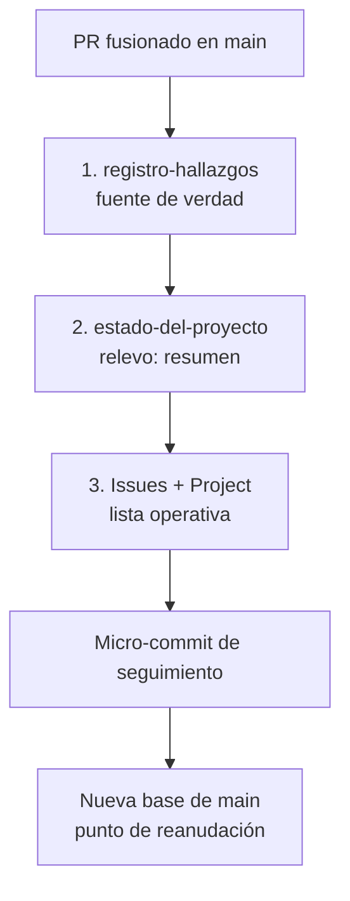

# Ficheros de seguimiento del proyecto Timón

Son dos documentos y un Project los que reparten el trabajo de memoria: `estado-del-proyecto` (relevo) dice dónde estamos y cómo seguir, `registro-hallazgos` guarda el histórico completo con evidencia y los issues del Project dicen qué toca hacer ahora.

## Vista general

| Fichero | Ubicación | Rol | Orden de lectura | Estilo |
|---|---|---|---|---|
| Issues + Project | GitHub (`ferboiar/timon`) | Hoja de ruta operativa | 1.º | Listas cortas |
| `estado-del-proyecto_1de3`, `_2de3`, `_3de3` (relevo) | `doc/mantenimiento/` | Guía de reanudación | 2.º, tras la instrucción persistente | Narrativo |
| `registro-hallazgos_1de3`, `_2de3`, `_3de3` | `doc/mantenimiento/` | Memoria histórica y detallada | 3.º, cuando se necesita el detalle | Exhaustivo |

Los dos últimos se dividen en 3 partes para no superar el límite de tamaño (unos 30.000 bytes por fichero).

## Issues y Project — la hoja de ruta operativa

Son los issues abiertos del Project: la lista corta y priorizada de tareas pendientes. Responden a «¿qué toca hacer ahora?» y son lo primero que se consulta al retomar el proyecto.

### Vista

- **Estado y prioridad**: cada issue lleva una etiqueta `P0`–`P3` y los campos `Estado`, `Prioridad` y `Orden` del Project.
- **Contenido**: el cuerpo del issue describe qué hay, alcance, fuera de alcance, criterios de aceptación, dependencias, archivos relevantes y fuente.
- **Cierre**: al fusionar el PR o cerrar el issue, el flujo del Project lo mueve a `Hecho`.

### Prioridades

| Prioridad | Significado | Ejemplos actuales |
|---|---|---|
| **P0** | Crítico, bloqueante, seguridad o integridad de datos. Se atiende primero. | S-04 (revocación JWT, rate limiting y guarda de último admin), S-05, S-11, S-21 |
| **P1** | Importante: funcionalidad o corrección con impacto real en el usuario. | D-45, D-43, DC-01, F-15, F-49, F-53, F-54, F-55, S-20 |
| **P2** | Mejora, refinamiento, deuda técnica no urgente. | D-44, U-25, F-37, F-39, F-40, U-02, U-09, U-11, U-20, F-56, O-10 |
| **P3** | Baja prioridad, mejora de proceso o cosmética. | U-01 a U-08, U-21 a U-23, O-01, O-03, O-05, S-08, D-37, D-38, D-39, D-40, S-23, O-09, R-14 |

Regla práctica: P0 antes que P1, P1 antes que P2, P2 antes que P3. Dentro de una misma prioridad se agrupa por área para hacer PRs coherentes, no uno por tarea.

## `estado-del-proyecto` (relevo) — guía de reanudación

Es la guía de continuidad: la «memoria de trabajo» que permite a un chat nuevo seguir sin perder contexto. Es más narrativa que los issues del Project, con prosa explicativa en vez de listas secas.

### Secciones

- **§0 — Estado actual y corte**: SHA de `main`, último PR fusionado e historial reciente. Más detallado que el Project.
  Ejemplo: `main en 926f544 (PR #84 fusionado, merge 926f544, 2026-11-12T12:28:25Z); antes, #83 con merge 83472a6`.
- **§1 — Contexto arquitectónico**: estructura macro (frontend, backend, base de datos, documentación), tecnologías y convenciones.
- **§2 — Fases de desarrollo**: fases completadas, en curso y siguientes.
- **§3 — Decisiones recientes**: decisiones (DC-xx) más recientes con un resumen de cada una.
- **§4 — Pendientes y limitaciones**: defectos abiertos, limitaciones conocidas y tareas pendientes con su estado.
- **§5 — Siguiente trabajo**: qué hacer a continuación, con la base actual y el contexto necesario.

## `registro-hallazgos` — memoria histórica

Es la fuente de verdad histórica: el «libro mayor» del proyecto. Si algo no está aquí, no pasó. Es el más largo y detallado de los tres.

### Secciones

- **§0 — Corte y decisiones**: base del corte, decisiones (DC-xx) con fecha y descripción, e historial de PRs.
- **§1 — Hallazgos cerrados**: defectos, incidencias y observaciones resueltos, con su evidencia (comandos, salidas, PRs).
- **§2 — Hallazgos pendientes**: los que siguen abiertos, con estado y prioridad.
- **§3 — Planificación**: tareas futuras por área y prioridad, con ID y descripción.
- **§4 — Evidencia**: comandos, salidas y pruebas que respaldan cada hallazgo o decisión.
- **§5 — Historial de PR**: PRs fusionados con SHA, fecha y descripción.

## Cómo se relacionan

- Issues + Project: vista corta y operativa («qué toca ahora» y «desde dónde parto»).
- Relevo: vista de continuidad («dónde estamos, qué se decidió, qué queda, cómo seguir»).
- Registro: vista histórica («qué se hizo, cuándo, por qué y con qué evidencia»).

La información fluye del registro al relevo (que resume) y del relevo a los issues (que priorizan). Al cerrar una iteración se actualizan en ese orden: primero el registro (fuente de verdad), luego el relevo, luego los issues.

### Diagrama de flujo

## Ejemplo: qué se toca en el PR #84

El orden es el mismo: registro, relevo e issues.

| Orden | Fichero | Secciones actualizadas | Cambio |
|---|---|---|---|
| 1 | `registro-hallazgos` | §0 | Añade la decisión DC-52 |
| 1 | `registro-hallazgos` | §1 | Cierra el hallazgo del visor (DC-56, U-24, D-42) |
| 1 | `registro-hallazgos` | §5 | Añade el PR #84 al historial |
| 2 | `estado-del-proyecto` | §0 y §5 | Actualiza la base a `926f544` (SHA de fusión del PR #84) |
| 2 | `estado-del-proyecto` | §3 | Añade la decisión DC-52 |
| 2 | `estado-del-proyecto` | §4 | Actualiza los pendientes |
| 3 | Issue del ID | Estado | Pasa a `Hecho` |
| 3 | Relevo | §0 | Nuevo corte |
| 3 | Project | Orden y estado | Se actualizan |
