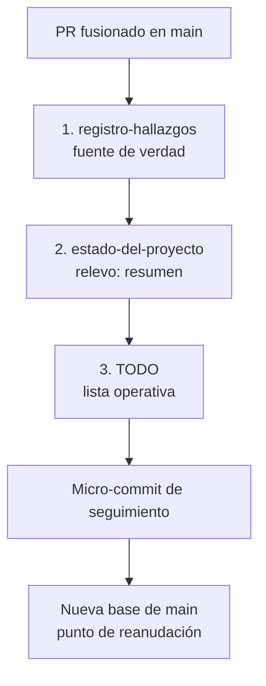

# Ficheros de seguimiento del proyecto Timón

Son tres documentos que se reparten el trabajo de memoria del proyecto: `TODO` dice qué toca hacer ahora, `estado-del-proyecto` (relevo) dice dónde estamos y cómo seguir, y `registro-hallazgos` guarda el histórico completo con evidencia.

## Vista general

| Fichero | Ubicación | Rol | Orden de lectura | Estilo |
|---|---|---|---|---|
| `TODO` | Raíz del repositorio | Hoja de ruta operativa | 1.º | Listas cortas |
| `estado-del-proyecto_1de3`, `_2de3`, `_3de3` (relevo) | `doc/mantenimiento/` | Guía de reanudación | 2.º, tras la instrucción persistente | Narrativo |
| `registro-hallazgos_1de3`, `_2de3`, `_3de3` | `doc/mantenimiento/` | Memoria histórica y detallada | 3.º, cuando se necesita el detalle | Exhaustivo |

Los dos últimos se dividen en 3 partes para no superar el límite de tamaño (unos 30.000 bytes por fichero).

## `TODO` — la hoja de ruta operativa

Es la lista corta y priorizada de tareas pendientes. Responde a «¿qué toca hacer ahora?» y es lo primero que lee un humano al retomar el proyecto.

### Secciones

- **Punto de reanudación** (línea 5): SHA actual de `main`, con el historial reciente de PRs y merges. Responde a «¿desde dónde parto?».
  Ejemplo: `Corte: main = 4bdcd09 (2026-11-12): micro-commit de seguimiento de DC-52 (relevo y TODO) tras el PR #84 (U-24, DC-56 y D-42, merge 926f544, 2026-11-12T12:28:25Z). Antes, el PR #83 (merge 83472a6) y el PR #82 (merge 2744e5a)…`
- **Estado operativo** (línea 35): fecha, base actual y resumen de lo último fusionado.
  Ejemplo: `Estado operativo: 2026-11-12, base 4bdcd09 (PR #84 fusionado con merge 926f544 y el micro-commit de DC-52).`
- **Backlog priorizado**: tareas pendientes agrupadas por prioridad y área. Cada una lleva un ID (S-xx, F-xx, U-xx, D-xx, DC-xx) y un estado: `[ ]` pendiente, `[x]` hecha, `[~]` en curso.
- **Casillas de tareas**: se marcan al cerrar la tarea, con nota del PR y la fecha.
  Ejemplo: `- [x] 8. PR #84 fusionado (merge 926f544, 2026-11-12T12:28:25Z)`.

### Prioridades

| Prioridad | Significado | Ejemplos actuales |
|---|---|---|
| **P0** | Crítico, bloqueante, seguridad o integridad de datos. Se atiende primero. | S-02/S-03 (seguridad de la base de datos), S-04 (revocación JWT, rate limiting, guarda de último admin), S-05, S-11, S-21 |
| **P1** | Importante: funcionalidad o corrección con impacto real en el usuario. | F-49 (UI de privacidad), F-53 (trazabilidad por fila), F-54 (resto de useAuth) |
| **P2** | Mejora, refinamiento, deuda técnica no urgente. | F-55 (validación de longitud de categoría), S-20 (prueba negativa) |
| **P3** | Baja prioridad, mejora de proceso o cosmética. | S-08 (herramienta de migraciones), F-15 (retirar comentario) |

Regla práctica: P0 antes que P1, P1 antes que P2, P2 antes que P3. Dentro de una misma prioridad se agrupa por área para hacer PRs coherentes, no uno por tarea.

## `estado-del-proyecto` (relevo) — guía de reanudación

Es la guía de continuidad: la «memoria de trabajo» que permite a un chat nuevo seguir sin perder contexto. Es más narrativa que el `TODO`, con prosa explicativa en vez de listas secas.

### Secciones

- **§0 — Estado actual y corte**: SHA de `main`, último PR fusionado e historial reciente. Más detallado que el `TODO`.
  Ejemplo: `main en 926f544 (PR #84 fusionado, merge 926f544, 2026-11-12T12:28:25Z); antes, #83 con merge 83472a6`.
- **§1 — Contexto arquitectónico**: estructura macro (frontend, backend, base de datos, documentación), tecnologías y convenciones.
- **§2 — Fases de desarrollo**: fases completadas, en curso y siguientes.
- **§3 — Decisiones recientes**: decisiones (DC-xx) más recientes con un resumen de cada una.
- **§4 — Pendientes y limitaciones**: defectos abiertos, limitaciones conocidas y tareas pendientes con su estado.
- **§5 — Siguiente trabajo**: qué hacer a continuación, con la base actual y el contexto necesario.

## `registro-hallazgos` — memoria histórica

Es la fuente de verdad histórica: el «libro mayor» del proyecto. Si algo no está aquí, no pasó. Es el más largo y detallado de los tres.

### Secciones

- **§0 — Corte y decisiones**: base del corte, decisiones (DC-xx) con fecha y descripción, e historial de PRs.
- **§1 — Hallazgos cerrados**: defectos, incidencias y observaciones resueltos, con su evidencia (comandos, salidas, PRs).
- **§2 — Hallazgos pendientes**: los que siguen abiertos, con estado y prioridad.
- **§3 — Planificación**: tareas futuras por área y prioridad, con ID y descripción.
- **§4 — Evidencia**: comandos, salidas y pruebas que respaldan cada hallazgo o decisión.
- **§5 — Historial de PR**: PRs fusionados con SHA, fecha y descripción.

## Cómo se relacionan

- `TODO`: vista corta y operativa («qué toca ahora» y «desde dónde parto»).
- Relevo: vista de continuidad («dónde estamos, qué se decidió, qué queda, cómo seguir»).
- Registro: vista histórica («qué se hizo, cuándo, por qué y con qué evidencia»).

La información fluye del registro al relevo (que resume) y del relevo al `TODO` (que prioriza). Al cerrar una iteración se actualizan en ese orden: primero el registro (fuente de verdad), luego el relevo, luego el `TODO`.

### Diagrama de flujo

## Ejemplo: qué se toca en el PR #84

El orden es el mismo: registro, relevo y `TODO`.

| Orden | Fichero | Secciones actualizadas | Cambio |
|---|---|---|---|
| 1 | `registro-hallazgos` | §0 | Añade la decisión DC-52 |
| 1 | `registro-hallazgos` | §1 | Cierra el hallazgo del visor (DC-56, U-24, D-42) |
| 1 | `registro-hallazgos` | §5 | Añade el PR #84 al historial |
| 2 | `estado-del-proyecto` | §0 y §5 | Actualiza la base a `926f544` (SHA de fusión del PR #84) |
| 2 | `estado-del-proyecto` | §3 | Añade la decisión DC-52 |
| 2 | `estado-del-proyecto` | §4 | Actualiza los pendientes |
| 3 | `TODO` | Casilla 8 | Pasa a `[x]` |
| 3 | `TODO` | Punto de reanudación | Pasa a `4bdcd09` |
| 3 | `TODO` | Estado operativo | Se actualiza |
