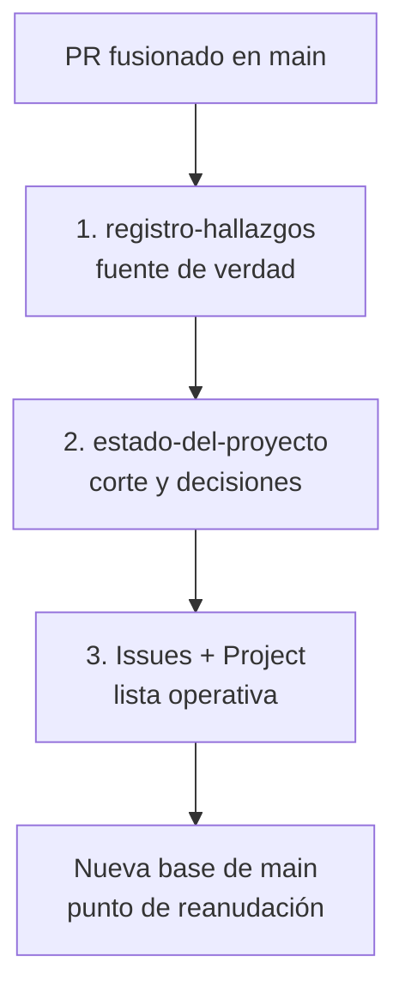

# Ficheros de seguimiento del proyecto Timón

Tres piezas reparten la memoria del proyecto: `.cline/rules` y `.cline/skills` fijan cómo se trabaja,
`estado-del-proyecto.md` (relevo) dice dónde estamos y cómo seguir, `registro-hallazgos` guarda el
histórico con evidencia y los issues del Project dicen qué toca hacer ahora.

## Vista general

| Fichero | Ubicación | Rol | Orden de lectura | Estilo |
|---|---|---|---|---|
| Issues + Project | GitHub (`ferboiar/timon`) | Hoja de ruta operativa | 1.º | Listas cortas |
| `.cline/rules/` y `.cline/skills/` | Raíz del repositorio | Reglas y procedimientos de trabajo | Al empezar | Normativo |
| `estado-del-proyecto.md` (relevo) | `doc/mantenimiento/` | Guía de reanudación | 2.º | Narrativo y breve |
| `registro-hallazgos_1de3`, `_2de3`, `_3de3` | `doc/mantenimiento/` | Memoria histórica y detallada | 3.º, cuando se necesita el detalle | Exhaustivo |

El relevo es un solo fichero desde DC-64; su corte anterior está en
`archivo/estado-del-proyecto-2026-11-16/`. Solo el registro se divide en partes.

## Issues y Project — la hoja de ruta operativa

Son los issues abiertos del Project: la lista corta y priorizada de tareas pendientes. Responden a «¿qué toca hacer ahora?» y son lo primero que se consulta al retomar el proyecto.

### Vista

- **Estado y prioridad**: cada issue lleva una etiqueta `P0`–`P3` y los campos `Estado`, `Prioridad` y `Orden` del Project.
- **Contenido**: el cuerpo del issue describe qué hay, alcance, fuera de alcance, criterios de aceptación, dependencias, archivos relevantes y fuente.
- **Cierre**: al fusionar el PR o cerrar el issue, el flujo del Project lo mueve a `Hecho`.

### Prioridades

| Prioridad | Significado |
|---|---|
| **P0** | Crítico, bloqueante, seguridad o integridad de datos. Se atiende primero. |
| **P1** | Importante: funcionalidad o corrección con impacto real en el usuario. |
| **P2** | Mejora, refinamiento o deuda técnica no urgente. |
| **P3** | Baja prioridad, mejora de proceso o cosmética. |

Regla práctica: P0 antes que P1, P1 antes que P2, P2 antes que P3. Dentro de una misma prioridad se agrupa por área para hacer PRs coherentes, no uno por tarea.

## `.cline/rules` y `.cline/skills` — cómo se trabaja

- `00-timon-obligatorio.md` y `01-proceso.md` se cargan siempre: rol, seguridad, autorización de publicación, edición de ficheros, plan/act, IDs, commits, PR y ramas.
- `10-frontend.md`, `20-backend.md`, `30-tests.md` y `40-documentacion.md` se activan por `paths`.
- Los procedimientos largos son skills y se cargan solo al usarse: `cierre-iteracion`, `limpieza-ramas` y `auditoria-documental`.
- Una regla, un sitio: no se copian en `doc/`. Los umbrales de tamaño están en DC-65.

## `estado-del-proyecto` (relevo) — guía de reanudación

Es la guía de continuidad: la «memoria de trabajo» que permite a un chat nuevo seguir sin perder contexto. Desde DC-64 es un solo fichero, corto, sin duplicar el backlog.

### Secciones

- **§0 — Corte**: fecha y base de `main`, último PR incorporado y comprobado, trabajo actual, objetivo, estado, próxima acción, bloqueos, migraciones aplicadas e issues abiertas relevantes.
- **§1 — Decisiones vigentes**: tabla de IDs con un resumen de una línea; el texto completo está en el registro §2.
- **§2 — Entorno y mapa**: stack, pruebas y dónde mirar por módulo.

## `registro-hallazgos` — memoria histórica

Es la fuente de verdad histórica: el «libro mayor» del proyecto. Si algo no está aquí, no pasó. Es el más largo y detallado de los tres.

### Secciones

- **§0 — Corte y decisiones**: base del corte, decisiones (DC-xx) con fecha y descripción, e historial de PRs.
- **§1 — Hallazgos cerrados**: defectos, incidencias y observaciones resueltos, con su evidencia (comandos, salidas, PRs).
- **§2 — Hallazgos pendientes**: los que siguen abiertos, con estado y prioridad.
- **§3 — Planificación**: tareas futuras por área y prioridad, con ID y descripción.
- **§4 — Evidencia**: comandos, salidas y pruebas que respaldan cada hallazgo o decisión.
- **§5 — Historial de PR**: PRs fusionados con SHA, fecha y descripción.

## Cómo se relacionan

- Issues + Project: vista corta y operativa («qué toca ahora»).
- Relevo: vista de continuidad («dónde estamos y cómo seguir»).
- Registro: vista histórica («qué se hizo, cuándo, por qué y con qué evidencia»).
- Reglas y skills: cómo se trabaja.

La información fluye del registro al relevo y del relevo a los issues. Al cerrar una iteración se actualizan en ese orden: primero el registro, luego el relevo §0 y después el issue.

### Diagrama de flujo

## Ejemplo: qué se toca en un PR

| Orden | Fichero | Secciones actualizadas | Cambio |
|---|---|---|---|
| 1 | `registro-hallazgos` | §0, §1 y §5 | Decisión, hallazgo e historial |
| 2 | `estado-del-proyecto` | §0 | Corte nuevo; el SHA de fusión lo da `git log`, no se copia (DC-64) |
| 3 | Issue del ID | Estado | Pasa a `Hecho` |
